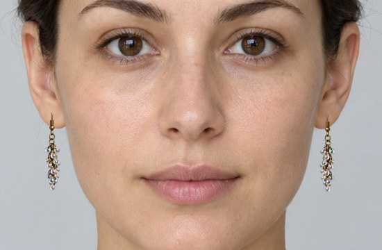

# Автоматическая посадка серёг: измерение и экспериментальный детектор

## Что готово

- `annotations.json`: два уникальных синтетических кадра из существующей папки,
  три видимые мочки и одно скрытое ухо. Координаты — визуальная разметка
  предполагаемого места крепления разработчиком с погрешностью ±10 px,
  **не наблюдаемые отверстия прокола**. Стороны указаны по изображению.
- `evaluate.py`: проверяет хеши фото, исключает дубликаты и сравнивает точки с
  разметкой. Отдельно считает пропуски и ошибочные точки на скрытом ухе.
- `bot/tryon/ear_segmentation.py`: локальная сегментация ушей через ONNX,
  отсечение маленьких/неуверенных/удалённых масок, оценка контакта в нижней
  части видимого уха. Учитывается ось наклона лица. Это оценка мочки по маске,
  не обученный детектор отверстия прокола.
- В `pipeline.py` предусмотрен явный выбор модели через `EAR_PARSER_MODEL`.
  В этом режиме серьга накладывается только на найденную сторону; скрытое
  ухо не дублируется. Если не найдено ни одного уха, бот просит другое фото.
  При пустой переменной полностью сохраняется прежняя геометрия.

## Результат и границы проверки

См. `research_report.json` и `research_model.json`. На этих двух кадрах
средняя ошибка текущей геометрии — около 31 px, экспериментального подхода —
около 5 px. Все три видимых уха найдены; скрытое не получило точку.
Ошибка ниже неопределённости ручной разметки не означает миллиметровую точность.
Это один синтетический персонаж, а не независимый тест на разных людях.
Коэффициент положения контакта внутри маски также эвристический (12% от низа).
Нельзя считать эти числа доказательством качества на закрытых волосами ушах.

На личных примерах проведена только локальная визуальная проверка. Их фото,
маски и разметка не добавляются в репозиторий. На фото с частично закрытыми
ушами модель иногда видит лишь фрагмент раковины: нижний край такого фрагмента
может не совпасть с мочкой. Фильтр уверенности не гарантирует обнаружение
этого случая.

## Ограничение весов — важно для запуска у заказчика

Для исследования использована `jonathandinu/face-parsing`. Её карточка явно
указывает **non-commercial research and educational purposes**:
https://huggingface.co/jonathandinu/face-parsing

Веса не входят в репозиторий, не скачиваются ботом и не включены по умолчанию.
Не используйте эти исследовательские веса в коммерческом боте без отдельного
разрешения правообладателей. Для рабочего запуска нужна модель с подходящими
правами и той же схемой входа/выхода, либо адаптация к другой модели.

## Воспроизведение

Из `vk_jewelry_bot`, в окружении с основными зависимостями:

```bash
pip install -r scripts/ear_calibration/requirements.txt
python scripts/ear_calibration/evaluate.py --output data/tmp/ear-baseline.json
python scripts/ear_calibration/evaluate.py --model /absolute/path/model.onnx --output data/tmp/ear-parser.json
```

В `research_model.json` зафиксированы ревизия, SHA-256 весов и подготовка
входа для воспроизведения исследования. Ссылка на файл имеет вид
`https://huggingface.co/jonathandinu/face-parsing/resolve/<revision>/onnx/model_quantized.onnx`.
Оценка по произвольному `--model` не проверяет лицензию или эквивалентность весов:
их происхождение необходимо фиксировать отдельно.

Для проверенной и разрешённой к использованию модели:

```dotenv
EAR_PARSER_MODEL=/absolute/path/approved-face-parser.onnx
```

Относительный путь считается от `vk_jewelry_bot`; после замены модели нужен
перезапуск. Для отключения удалите переменную и перезапустите процесс.
ONNX Runtime работает на CPU; в этом окружении один кадр занимал около 3 с.
При неверном пути/формате модель выдаёт ошибку, а не незаметно подменяется
старой формулой. Ввод: float32 RGB NCHW 1x3x512x512, нормализация ImageNet.
Вывод: logits 1x19xHxW, классы ушей 8 и 9. Подробности — в модуле.

## Что необходимо для выпуска

1. Получить разрешённые веса или дообучить модель на данных с нужными правами.
2. Добавить независимую размеченную выборку разных людей, ракурсов, освещения
   и степени закрытия ушей. Не смешивать одного человека между обучением
   и итоговым тестом; дубликаты файлов не увеличивают выборку.
3. Сравнить ошибку, долю найденных видимых ушей и ложные срабатывания на
   скрытых ушах. Отдельно проверить точку крепления PNG, поворот и масштаб.
4. Включать модель у заказчика после этой проверки. Текущий коммит готовит
   измерение и подключение, но не объявляет исследовательские веса готовыми
   к коммерческому выпуску.

## Пример полного наложения

Синтетическое калибровочное фото, «Серьги с капельками», исследовательский режим:


